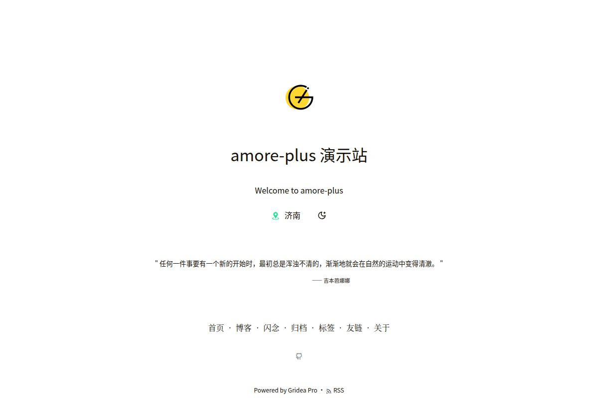
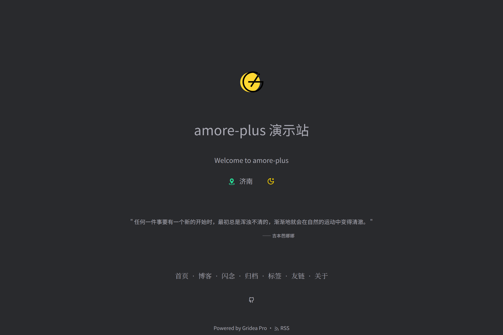
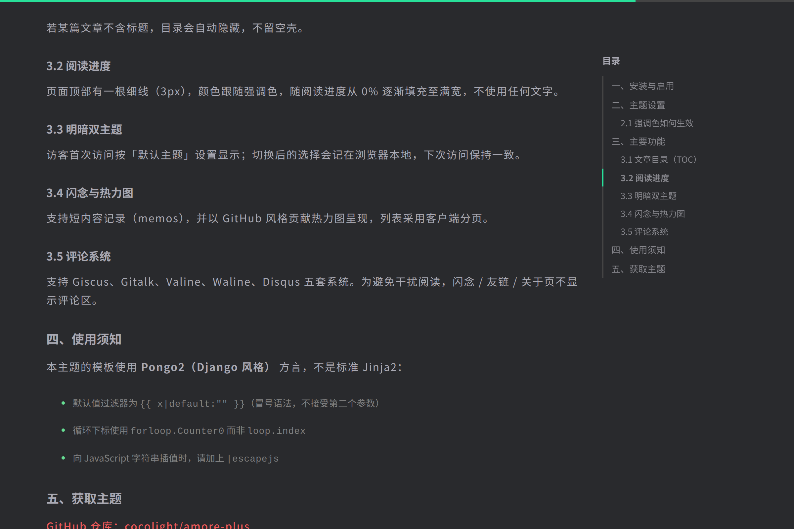
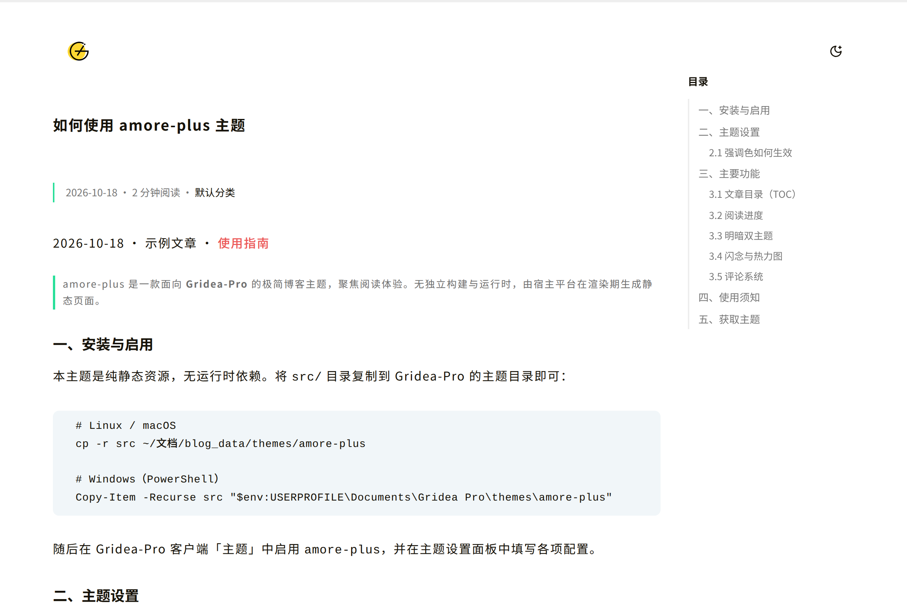
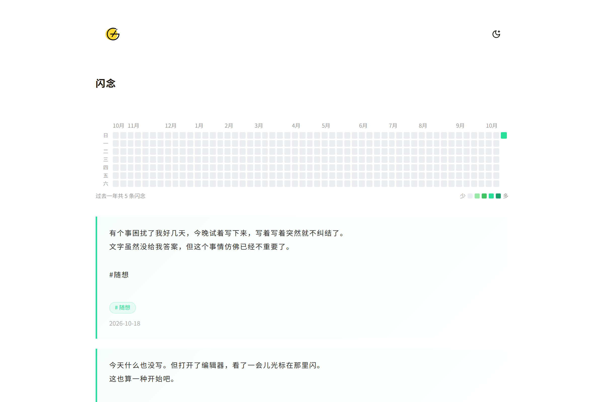
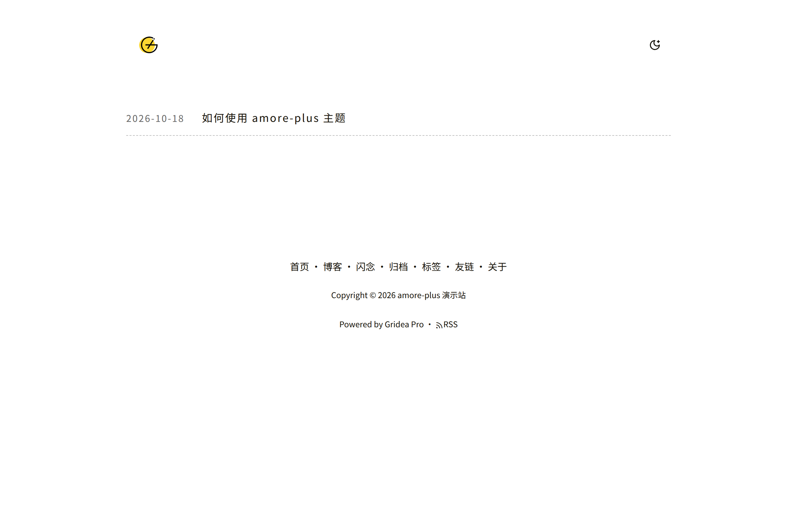

# amore-plus

一款面向 [Gridea-Pro](https://github.com/Gridea-Pro/gridea-pro) 的极简博客主题，聚焦阅读体验。无独立构建与运行时，由宿主平台在渲染期生成静态页面。



## 在线演示

**[打开演示站点 →](https://cocolight.github.io/amore-plus/)**

演示站点是一个完整的示例博客，含首页、博客列表、闪念、归档、分类、标签、友链、关于与多篇示例文章，可直接体验目录跟随、阅读进度与明暗切换。

## 特性

- **文章目录（TOC）**：正文 `h2`/`h3` 自动生成右侧目录，点击平滑跳转；滚动时高亮当前章节并让目录面板自动跟随，长文章无需手动翻目录；不含标题的文章自动隐藏目录。
- **阅读进度**：页面顶部 3px 细线，颜色跟随强调色，随阅读进度填充，无任何文字，移动端同样显示。
- **明/暗双主题**：首次访问按配置显示，访客切换后记忆在本地；强调色可配。
- **五套评论系统**：Giscus、Gitalk、Valine、Waline、Disqus。评论区仅出现在文章页，闪念 / 友链 / 关于页不显示。
- **闪念与热力图**：短内容记录 + GitHub 风格贡献热力图，客户端分页。
- **完整站点**：归档、分类、标签、友链、关于、404、RSS、站点地图、Open Graph、可选 Google Analytics。
- **可扩展**：25 项主题设置，另支持自定义 CSS / JavaScript。

更多截图：

| 首页（深色） | 目录跟随 |
|---|---|
|  |  |

| 文章页 | 闪念与热力图 |
|---|---|
|  |  |

| 博客列表 |
|---|
|  |

## 安装

将 `src/` 目录复制到 Gridea-Pro 的主题目录：

```bash
# Linux / macOS
cp -r src ~/文档/blog_data/themes/amore-plus

# Windows（PowerShell）
Copy-Item -Recurse src "$env:USERPROFILE\Documents\Gridea Pro\themes\amore-plus"
```

随后在 Gridea-Pro 客户端「主题」中启用 `amore-plus`，并在主题设置面板中填写配置。

## 主题设置

共 **25 项**，位于 `config.json` 的 `customConfig`，按分组呈现：

| 分组 | 包含项 |
|---|---|
| 基础设置 | 站点 Logo、站点图标、页脚信息 |
| 首页信息 | 地理位置、格言内容、格言作者 |
| 外观设置 | 默认主题、主题强调色 |
| 社交链接 | GitHub、Twitter、微博、知乎、Facebook |
| 统计分析 | Google Analytics 跟踪 ID |
| Giscus 评论 | 仓库、repoId、分类、categoryId、映射、表情回应、输入框位置、语言、主题 |
| 高级设置 | 自定义 CSS、自定义 JavaScript |

## 启用评论

在 Gridea-Pro 后台「设置 → 评论」中开启评论并选择平台，填入对应配置即可。

> 目前经浏览器端实测可用的是 **Giscus**；其余四套已完成模板适配（已适配 Gridea-Pro 的平台常量大小写与配置字段），但尚未逐一实测。

## 环境要求

- Gridea-Pro 客户端
- 无运行时依赖，主题为纯静态资源

## 自定义模板（重要）

本主题模板使用 **Pongo2（Django 风格）** 方言，**不是标准 Jinja2**。修改模板时请注意：

- 默认值过滤器为 `{{ x|default:"" }}`（**冒号语法，不接受第二个参数**）。
  写成 Jinja2 风格的 `{{ x|default('', true) }}` 会导致**整页渲染降级**。
- 循环下标使用 `forloop.Counter0` 而非 `loop.index`。
- 向 JavaScript 字符串插值时，请加 `|escapejs`。

验证方式：主题无独立单元测试，请在 Gridea-Pro 中重新构建后确认目标页面**没有出现「⚠️ 降级视图」提示**。

## 作者

[@cocolight](https://github.com/cocolight)

## 授权

[MIT](LICENSE)
